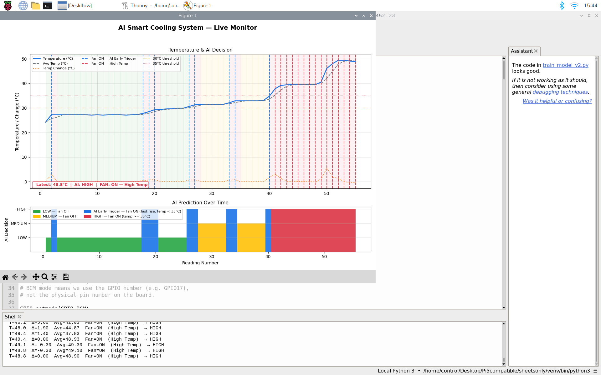

# AI Smart Cooling System with Raspberry Pi 5

An AI-powered smart cooling system that uses a trained Random Forest machine learning model to detect rapid temperature rises and activate a cooling fan **before overheating occurs** — proactive cooling, not reactive.

---

## Demo



---

## How It Works

Instead of waiting for the temperature to cross a fixed threshold, the AI model detects **fast temperature rises** in real time and activates the fan early — even at low temperatures.

| Trigger | Condition | Result |
|---------|-----------|--------|
| AI Early Trigger | Fast rise detected (Δ ≥ 0.5°C/reading) | Fan ON before 35°C |
| High Temp Trigger | Temperature ≥ 35°C | Fan ON at threshold |
| MEDIUM | 30°C ≤ temp < 35°C, stable | Yellow LED only |
| LOW | temp < 30°C, stable | Green LED only |

---

## Project Structure

```
AI-Smart-Cooling-System/
├── src/
│   ├── smart_logging_v2.py      # Step 1 — Collect sensor data to Google Sheets
│   ├── train_model_v2.py        # Step 2 — Train the Random Forest AI model
│   └── ai_final.py              # Step 3 — Live AI control + real-time graph
├── models/
│   └── model_v2.pkl             # Trained Random Forest model
├── docs/
│   ├── how_it_works.txt         # Detailed explanation of AI logic
│   ├── setup_and_run.txt        # Full setup and installation guide
│   ├── system_explanation.txt   # Technical system breakdown
│   └── wiring.txt               # GPIO wiring for all components
├── demo/                        # Hardware photos and screenshots
├── requirements.txt
└── README.md
```

---

## Hardware

| Component | GPIO (BCM) | Role |
|-----------|------------|------|
| DHT11 Sensor | GPIO 4 | Reads temperature and humidity every 2 seconds |
| Green LED | GPIO 17 | LOW temperature indicator (temp < 30°C) |
| Yellow LED | GPIO 27 | MEDIUM temperature indicator (30–35°C) |
| Red LED | GPIO 22 | HIGH temperature indicator (temp ≥ 35°C or fast rise) |
| Fan LED | GPIO 24 | Cooling fan output — ON whenever AI predicts HIGH |

---

## AI Pipeline

**Step 1 — Data Collection** (`smart_logging_v2.py`)
- Reads DHT11 sensor every 2 seconds
- Calculates `temp_change` (rate of rise) and `avg_temp` (rolling average of 3 readings)
- Logs all data automatically to Google Sheets

**Step 2 — Model Training** (`train_model_v2.py`)
- Loads CSV data from Google Sheets
- Labels each reading using fast-rise priority logic
- Trains a Random Forest Classifier (200 trees, class_weight='balanced')
- Saves trained model as `model_v2.pkl`

**Step 3 — Live AI Control** (`ai_final.py`)
- Loads `model_v2.pkl`
- Feeds 4 features to the model every 2 seconds: `temperature`, `humidity`, `temp_change`, `avg_temp`
- Controls LEDs and fan based on AI prediction
- Displays a live real-time graph with colour-coded AI decisions

---

## Model Evaluation

The training labels come from a rule: a reading is HIGH if the temperature rises by 0.5°C or more with a rolling average above 25°C, or if it reaches 35°C; otherwise it is MEDIUM (30–35°C) or LOW. The Random Forest therefore learns to reproduce that rule from four features. A 100% score on the training data (1,160 rows) shows the rule was learned, not how well the model generalizes.

To check that the rule is learned on readings the model has not seen, rather than memorized, `train_model_v2.py` holds out a stratified 20% test split, reports per-class precision and recall on it, and then retrains on all the data for deployment. Because the labels are deterministic, a high held-out score is expected; the step that would make this a genuine predictor is described under Next Steps.

| Metric | Value |
|--------|-------|
| Logged readings | 1,160 |
| Held-out test accuracy | *re-run `train_model_v2.py` to fill in* |
| Feature importance | temperature 0.50 · avg_temp 0.29 · temp_change 0.16 · humidity 0.05 |
| Hand-written scenario checks | 5/5 passed |

`temp_change` carries 16% of the importance, which confirms the model uses the rate of rise and not just the absolute temperature.

## Limitations and Next Steps

- **Labels encode a rule.** Labelling each reading by whether the temperature *actually* crossed 35°C within the next N readings would turn this into a true early-warning predictor rather than a rule imitator.
- **Small fast-rise class.** Only about 17 fast-rise examples occur at low or medium temperatures, so more logging under fast-heating conditions would make the early trigger more reliable.
- **Single sensor.** The DHT11 has ±2°C accuracy and 1°C resolution; a DHT22 or DS18B20 would give cleaner `temp_change` values.

---

## Installation

```bash
pip install RPi.GPIO dht11 scikit-learn joblib pandas matplotlib
pip install google-auth google-auth-httplib2 google-auth-oauthlib google-api-python-client
```

See `docs/setup_and_run.txt` for the full step-by-step setup guide including virtual environment, Google Sheets API, and hardware wiring.

---

## Running the System

```bash
# Step 1 — Collect training data
python3 src/smart_logging_v2.py

# Step 2 — Train the model
python3 src/train_model_v2.py

# Step 3 — Run the live system
python3 src/ai_final.py
```

---

## Built With

- Python 3.13
- scikit-learn — Random Forest Classifier
- Raspberry Pi OS 64-bit
- Google Sheets API — automated data logging
- Matplotlib — live real-time graph
- RPi.GPIO — hardware control

---

## Documentation

Full documentation is available in the `docs/` folder:
- `how_it_works.txt` — AI logic, fan triggers, graph explanation
- `setup_and_run.txt` — complete installation and run guide
- `system_explanation.txt` — technical breakdown of the ML approach
- `wiring.txt` — full GPIO wiring with pin numbers and resistor values
